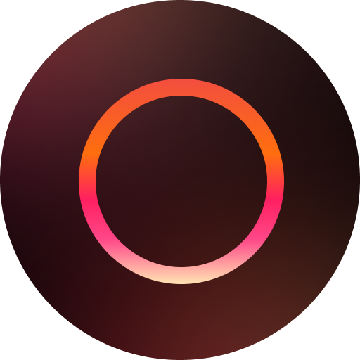
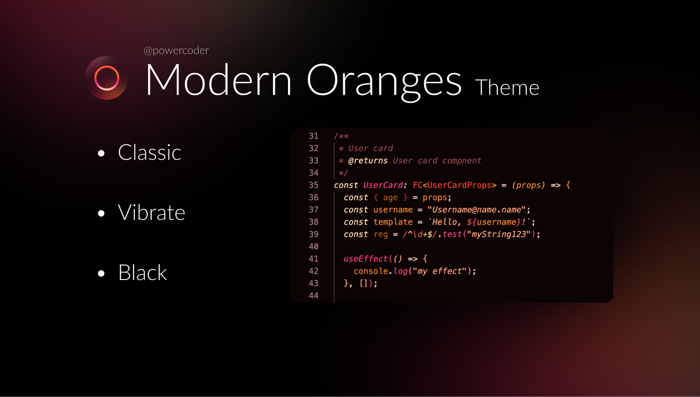

# 🍊 Modern Oranges for Zed

> **Note**
> The blur effect may not work on all operating systems. This is a limitation of Zed's window transparency implementation, not a theme issue. If you experience issues with blur, please report them to the [Zed repository](https://github.com/zed-industries/zed).

<p align="center">
  
</p>

<p align="center">
  The <a href="https://github.com/nithenz/modern-oranges-theme">Modern Oranges</a> VS Code theme for <a href="https://zed.dev">Zed</a>, with a blurred, translucent window background.
</p>

<p align="center">
  
</p>

## 🎨 Variants

Six variants, each in three blur levels: 18 themes in total. The plain `(Blur)` name is the default (medium) level, `[Light]` is more transparent and `[Heavy]` is more opaque.

| Variant | Background |
| --- | --- |
| Modern Oranges | Classic dark gray, upright text |
| Modern Oranges Operator | Classic dark gray, with italics |
| Modern Oranges Vibrate | Warm dark, saturated, with italics |
| Modern Oranges Vibrate Dark | Near-black red tint, with italics |
| Modern Oranges Vibrate Gray | Neutral dark gray, with italics |
| Modern Oranges Black | Pure black, with italics |

The themes are generated from the original VS Code theme files, so the token colors match VS Code: orange variables, coral keywords and types, pink functions, salmon strings.

## 📦 Installation

Search for **Modern Oranges** in Zed's Extensions page (`zed: extensions`), then pick a variant in the theme selector (`theme selector: toggle`), for example `Modern Oranges Vibrate (Blur)`.

To install from source, clone this repository, click **Install Dev Extension** on the Extensions page and select the cloned folder.

## ⚙️ Recommended Settings

<details>
<summary>Click to expand</summary>

For the best experience, add the following to your Zed settings:

```json
{
  "project_panel": {
    "sticky_scroll": false
  }
}
```

This disables sticky scroll in the project panel, which can interfere with the blur effect on the panel overlays.

The Operator and Vibrate variants use italics for keywords, strings, parameters and functions, as the VS Code originals do. They look best with a font that has a cursive italic (Operator Mono, Victor Mono, Monaspace Radon, Maple Mono).
</details>

## 🧩 How the VS Code theme is mapped to Zed

Zed highlights with tree-sitter captures (`keyword.control`, `function.method`, `type.builtin`, ...) instead of TextMate scopes. `modern_oranges.mjs` maps every Zed capture to a representative TextMate scope stack and resolves it against the upstream VS Code `tokenColors` with TextMate selector rules, so each capture gets the color (and italic) VS Code renders for that scope.

Because Zed's captures are coarser than TextMate scopes, a few decisions were made:

- Zed's generic `keyword` capture (modifiers like `async`, `static`, `pub`, and word operators like `new`, `typeof`, `in`) uses the theme's keyword color (coral). Declarations (`const`, `function`, `class`), imports and control flow (`if`, `return`, `await`) get their own VS Code colors.
- `property` covers member access, object keys and struct fields in Zed. It uses the variable color, which is what VS Code shows for member access.
- Operators stay upright even in the italic variants.
- Zed captures `${ }` template delimiters, the `:` of type annotations and `|` in union types as `punctuation.special`; they share the template-expression color.
- `comment.todo`, `comment.error` and friends do not exist in VS Code themes and use palette colors.
- Git-ignored files in the project and git panels use the comment color instead of VS Code's blue-gray ignored color.
- UI colors come from the VS Code `colors` map where defined (selection, scrollbars, indent guides, git decorations, bracket colors as Zed `accents`). Missing ones use per-family defaults in `FAMILY_DEFAULTS`; the terminal ANSI palette is VS Code's default dark palette, since that is what the VS Code theme shows.

Use `node sync_theme.mjs --verbose` to print the resolved colors per variant.

## 🔧 Development

`themes/modern-oranges-blur.json` is generated by `sync_theme.mjs` (Node 20+, no dependencies):

```bash
node sync_theme.mjs
```

The script fetches the upstream [Modern Oranges VS Code theme files](https://github.com/nithenz/modern-oranges-theme) (cached in `.cache/`), converts them with `modern_oranges.mjs`, applies the blur levels from `blur.mjs`, validates the result and writes the theme file.

| Flag | Purpose |
| --- | --- |
| `--offline` | Use only the cached upstream copies in `.cache/` |
| `--modern-oranges DIR` | Use a local checkout of `modern-oranges-theme/themes` |
| `--check` | Build and fail if the committed theme file differs |
| `--validate` | Only validate the committed theme file (used by CI) |
| `--verbose` | Print the resolved palette and token colors |

**Important**: do not edit `themes/modern-oranges-blur.json` by hand. It is overwritten by the sync script.

### Customizing

- **Blur levels**: `BLUR_LEVELS` in `blur.mjs`.
- **Token colors**: `SYNTAX_MAP` in `modern_oranges.mjs`. Change the scope a Zed capture resolves to, force a palette color with `color`, or force italics with `italic`.
- **UI colors**: `FAMILY_DEFAULTS` and `buildPalette()` in `modern_oranges.mjs`.
- **Blur overrides**: `buildBlurOverrides()` in `modern_oranges.mjs`.
- **One-off tweaks per variant**: `VARIANT_STYLE_OVERRIDES` in `modern_oranges.mjs` (applied last).

After changing anything, run `node sync_theme.mjs` and then `zed: reload extensions` in Zed's command palette. `dev: open highlights tree view` shows which capture and theme key a token resolves to.

### Workflows

- `sync-theme.yml` runs daily and opens a PR when the upstream VS Code theme changed.
- `check.yml` validates the committed theme file on every push and PR.
- `manual-release.yml` bumps the version, regenerates, tags and dispatches `publish-extension.yml`, which opens the version-bump PR on [zed-industries/extensions](https://github.com/zed-industries/extensions) from your fork (needs the `COMMITTER_TOKEN` secret).

## 🙏 Credits

- The blur levels and translucent UI approach come from [Catppuccin Blur for Zed](https://github.com/jenslys/zed-catppuccin-blur) by Jens Lystad

## 📄 License

MIT, see [LICENSE](LICENSE).
